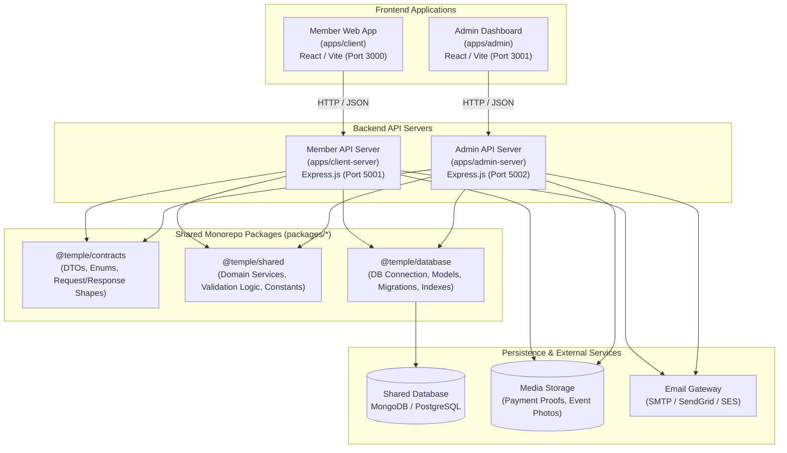

# Architecture Specification
## Temple Management System — Monorepo Architecture & Two-Server Strategy

---

## 1. High-Level Architecture Overview

The Temple Management System is structured as a **monorepo** dividing client-facing applications, administrative portals, and shared core packages.



---

## 2. Why Two Separate API Servers?

### 2.1 Security & Attack Surface Isolation
- **Member Server (`apps/client-server`)**:
  - Exposed publicly to members and visitors.
  - Contains **zero admin route handlers**, **zero admin authorization middlewares**, and **zero admin database modification pathways**.
  - Even if an exploit or token forgery is attempted on the client server, administrative functions (e.g. approving payments, deleting notifications, overriding fraud flags) physically do not exist in the client process memory or route table.
- **Admin Server (`apps/admin-server`)**:
  - Dedicated to the single administrator.
  - Can be placed behind an IP whitelist, VPN, or distinct subnetwork/firewall.
  - Separate JWT secret and issuer (`ADMIN_JWT_SECRET` vs `MEMBER_JWT_SECRET`).

### 2.2 Independent Scalability & Deployment
- High traffic on festival days or event announcements hits only `client-server` without impacting administrative operations and payment verifications.

---

## 3. The Core Challenge: Preventing Business Logic Duplication

Because `client-server` and `admin-server` operate as separate backend services, **business logic drift** is a critical architectural risk. If payment submission validation in `client-server` diverges from payment verification rules in `admin-server`, fraud detection and financial integrity break.

### 3.1 The "Single Source of Truth" Rules

To guarantee complete consistency:

| Layer | Location | Responsibility | Rule |
| :--- | :--- | :--- | :--- |
| **Enums & Types** | `packages/contracts` | All status strings, modes, audiences, error codes. | **Strictly forbidden** to write raw string literals like `'PAID'` or `'Pending'` inside server controllers. Always use `PaymentStatus.PAID`. |
| **Data Validation** | `packages/shared/validators` | Request body validation schemas (Zod/Joi). | Both `client-server` and `admin-server` consume the exact same validation schemas for member data, contributions, and events. |
| **Domain Logic** | `packages/shared/services` | Business operations, state transitions, calculations. | Calculation of fraud threshold (fake attempts > 5), red border status, soft-delete invariants live in shared services. |
| **Data Models** | `packages/database/models` | Database schemas, relationships, query helpers. | Both servers connect to the same DB using the exact same model definitions and indexes. |

```
                               ┌────────────────────────────────┐
                               │     packages/contracts         │
                               │  - PaymentStatus               │
                               │  - EventStatus                 │
                               │  - TargetAudience              │
                               └──────────────┬─────────────────┘
                                              │
                      ┌───────────────────────┴────────────────────────┐
                      ▼                                                ▼
       ┌───────────────────────────────┐               ┌───────────────────────────────┐
       │      packages/shared          │               │      packages/database        │
       │  - contribution.validator.js  │               │  - Contribution.model.js      │
       │  - fraud.service.js           │               │  - Member.model.js            │
       │  - event.service.js           │               │  - Event.model.js             │
       └──────────────┬────────────────┘               └───────────────┬───────────────┘
                      │                                                │
         ┌────────────┴───────────────────────────────┐                │
         ▼                                            ▼                ▼
┌───────────────────────────────┐       ┌───────────────────────────────┐
│       apps/client-server      │       │       apps/admin-server       │
│  (Member API Routes)          │       │  (Admin API Routes)           │
│  - Thin controller adapter    │       │  - Thin controller adapter    │
└───────────────────────────────┘       └───────────────────────────────┘
```

---

## 4. Key Domain Invariant Implementations

### 4.1 Payment Verification & Fraud Handling Invariant
When an admin flags a submission as fake in `admin-server`:
1. `AdminServer` calls `FraudService.recordFraudAttempt({ memberId, contributionId, adminId, reason })` in `packages/shared/services/fraud.service.js`.
2. The service increments `member.fakePaymentCount`.
3. If `member.fakePaymentCount > 5`, the service sets `member.hasRedBorder = true`.
4. When `client-server` queries any member data or when member profile/feed is fetched, `hasRedBorder` is read directly from the model.

### 4.2 Member Account Deletion & Re-registration
- **Soft Delete:** Setting `member.isActive = false` removes the member's login ability.
- **Unique Constraint:** The unique index on `mobileNumber` is a **partial unique index** (`{ mobileNumber: 1 }` where `{ isActive: true }`).
- **Audit Preservation:** All previous contributions retain `memberId = oldMemberId`. A new registration with the same mobile number gets a new unique `_id`.

### 4.3 Event Cancellation Invariant
- Admin triggers cancellation: `event.status = EventStatus.CANCELLED`, `event.cancelledAt = new Date()`.
- Member feed query in `client-server`:
  - Retrieves cancelled events where `cancelledAt > Date.now() - 24 hours`.
  - After 24 hours, automatically omitted from member feed.
  - Contributions linked to cancelled events remain intact and queryable with `isEventCancelled: true`.

---

## 5. Standardized API Response Envelope

Both `client-server` and `admin-server` must return the identical JSON envelope structure defined in `@temple/contracts`:

### Success Response:
```json
{
  "success": true,
  "data": { ... },
  "message": "Operation completed successfully"
}
```

### Error Response:
```json
{
  "success": false,
  "error": {
    "code": "VALIDATION_ERROR",
    "message": "Mobile number must be 10 digits",
    "details": [ ... ]
  }
}
```

---

## 6. Monorepo Package Management & Dependencies

Using root `workspaces`:
```json
{
  "name": "temple-management",
  "private": true,
  "workspaces": [
    "apps/*",
    "packages/*"
  ]
}
```

Each app's `package.json` declares dependencies on local packages:
```json
{
  "dependencies": {
    "@temple/contracts": "*",
    "@temple/shared": "*",
    "@temple/database": "*"
  }
}
```
This enables zero-copy, direct symlinked resolution between the apps and shared logic.
