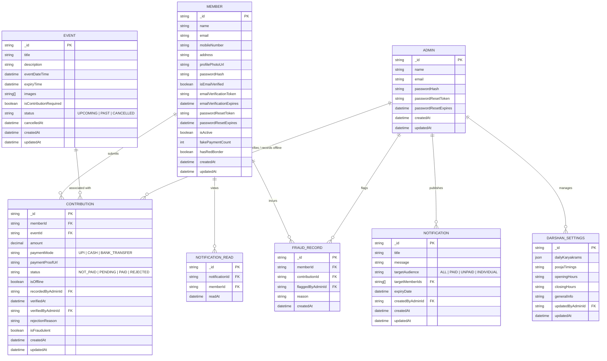

# Database Design & Schema Specification
## Temple Management System — Shared Data Layer (`packages/database`)

---

## 1. Entity-Relationship Overview

---

## 2. Collections / Tables Specification

### 2.1 `members` Collection
Stores member profiles and authentication state.

| Field | Type | Constraints | Description |
| :--- | :--- | :--- | :--- |
| `_id` | ObjectId / UUID | Primary Key | Unique member identifier |
| `name` | String | Required, Trimmed | Full name of member |
| `email` | String | Required, Lowercase | Email address (**Immutable** after registration) |
| `mobileNumber` | String | Required, 10-digits | Primary mobile number |
| `address` | String | Required | Physical residential address |
| `profilePhotoUrl` | String | Optional, Nullable | Cloud/local image path |
| `passwordHash` | String | Required | Argon2 / Bcrypt hash |
| `isEmailVerified` | Boolean | Default: `false` | Must be `true` for member app login |
| `emailVerificationToken` | String | Nullable | Single-use token for email verification |
| `emailVerificationExpires`| DateTime | Nullable | Expiration timestamp for token |
| `passwordResetToken` | String | Nullable | Single-use token for password reset |
| `passwordResetExpires` | DateTime | Nullable | Expiration timestamp for reset token |
| `isActive` | Boolean | Default: `true` | Soft-deletion flag (`false` when self-deleted) |
| `fakePaymentCount` | Integer | Default: `0` | Number of confirmed fraudulent payments |
| `hasRedBorder` | Boolean | Default: `false` | True when `fakePaymentCount > 5` or manual override |
| `createdAt` | DateTime | Auto | Registration timestamp |
| `updatedAt` | DateTime | Auto | Last updated timestamp |

**Indexes:**
- `{ mobileNumber: 1 }` with partial filter `{ isActive: true }` (Unique). Ensures active accounts cannot have duplicate mobile numbers, but allows reuse after deletion.
- `{ email: 1 }` with partial filter `{ isActive: true }` (Unique).
- `{ hasRedBorder: 1 }` for fast query of flagged users.

---

### 2.2 `admins` Collection
Supports single administrator account for V1.

| Field | Type | Constraints | Description |
| :--- | :--- | :--- | :--- |
| `_id` | ObjectId / UUID | Primary Key | Unique admin identifier |
| `name` | String | Required | Administrator display name |
| `email` | String | Required, Unique | Admin login email |
| `passwordHash` | String | Required | Securely hashed password |
| `passwordResetToken` | String | Nullable | Single-use email recovery token |
| `passwordResetExpires` | DateTime | Nullable | Expiry for recovery token |
| `createdAt` | DateTime | Auto | Account creation timestamp |
| `updatedAt` | DateTime | Auto | Account update timestamp |

---

### 2.3 `events` Collection
Stores temple events and pooja occurrences.

| Field | Type | Constraints | Description |
| :--- | :--- | :--- | :--- |
| `_id` | ObjectId / UUID | Primary Key | Unique event identifier |
| `title` | String | Required, Trimmed | Event title |
| `description` | String | Required | Comprehensive event details |
| `eventDateTime` | DateTime | Required | Scheduled event start time |
| `expiryTime` | DateTime | Required | Cutoff time after which event becomes past |
| `images` | Array<String> | Required, Default: `[]` | Array of image URLs/paths; uses fallback if empty |
| `isContributionRequired`| Boolean | Default: `false` | Whether Kanikai is requested for this event |
| `status` | String (Enum) | `UPCOMING` \| `PAST` \| `CANCELLED` | Lifecycle state of event |
| `cancelledAt` | DateTime | Nullable | Timestamp when admin cancelled event |
| `createdAt` | DateTime | Auto | Creation timestamp |
| `updatedAt` | DateTime | Auto | Last modified timestamp |

**Indexes:**
- `{ status: 1, eventDateTime: 1 }` for retrieving nearest upcoming event for Darshan Feed.
- `{ status: 1, cancelledAt: 1 }` for fetching cancelled events within 24-hour window.

---

### 2.4 `contributions` Collection (Kanikai)
Stores all financial contributions made by members online and recorded by admin offline.

| Field | Type | Constraints | Description |
| :--- | :--- | :--- | :--- |
| `_id` | ObjectId / UUID | Primary Key | Unique contribution record ID |
| `memberId` | ObjectId / UUID | Required, FK -> `members` | Member who contributed |
| `eventId` | ObjectId / UUID | Required, FK -> `events` | Event contributed toward |
| `amount` | Decimal / Number | Required, Min: 1 | Contributed amount in INR |
| `paymentMode` | String (Enum) | `UPI` \| `CASH` \| `BANK_TRANSFER` | Payment channel |
| `paymentProofUrl` | String | Required for online UPI | Uploaded receipt/screenshot URL |
| `status` | String (Enum) | `NOT_PAID` \| `PENDING` \| `PAID` \| `REJECTED` | Current verification status |
| `isOffline` | Boolean | Default: `false` | True if entered manually by admin |
| `recordedByAdminId` | ObjectId / UUID | Nullable, FK -> `admins` | Admin ID if offline entry |
| `verifiedAt` | DateTime | Nullable | Verification timestamp |
| `verifiedByAdminId` | ObjectId / UUID | Nullable, FK -> `admins` | Admin ID who verified |
| `rejectionReason` | String | Nullable | Reason provided if rejected |
| `isFraudulent` | Boolean | Default: `false` | True if flagged as fake payment attempt |
| `createdAt` | DateTime | Auto | Submission timestamp |
| `updatedAt` | DateTime | Auto | Last update timestamp |

**Critical Invariants:**
- **NEVER HARD DELETED**: Deleting a member or cancelling an event must NEVER remove or nullify rows in this table.
- **Indexes:**
  - `{ memberId: 1, createdAt: -1 }`: For Member's Contribution History.
  - `{ eventId: 1, status: 1 }`: For Event Collection Reports & aggregates.
  - `{ status: 1, createdAt: -1 }`: For Admin pending verifications view.

---

### 2.5 `fraud_records` Collection
Audit log of every confirmed fake payment attempt.

| Field | Type | Constraints | Description |
| :--- | :--- | :--- | :--- |
| `_id` | ObjectId / UUID | Primary Key | Unique fraud record identifier |
| `memberId` | ObjectId / UUID | Required, FK -> `members` | Flagged member |
| `contributionId` | ObjectId / UUID | Required, FK -> `contributions` | Related contribution submission |
| `flaggedByAdminId` | ObjectId / UUID | Required, FK -> `admins` | Admin who flagged fraud |
| `reason` | String | Required | Notes on why payment was marked fraudulent |
| `createdAt` | DateTime | Auto | Timestamp of flagging |

**Indexes:**
- `{ memberId: 1 }`: For counting historical fraud attempts.

---

### 2.6 `notifications` Collection
Stores announcements created by admin.

| Field | Type | Constraints | Description |
| :--- | :--- | :--- | :--- |
| `_id` | ObjectId / UUID | Primary Key | Unique notification identifier |
| `title` | String | Required | Notification headline |
| `message` | String | Required | Full notification body |
| `targetAudience` | String (Enum) | `ALL` \| `PAID` \| `UNPAID` \| `INDIVIDUAL` | Target group |
| `targetMemberIds` | Array<ObjectId> | Default: `[]` | List of member IDs if `INDIVIDUAL` |
| `expiryDate` | DateTime | Required | When notification ceases displaying |
| `createdByAdminId`| ObjectId / UUID | Required, FK -> `admins` | Author |
| `createdAt` | DateTime | Auto | Created timestamp |
| `updatedAt` | DateTime | Auto | Updated timestamp |

**Indexes:**
- `{ expiryDate: 1 }`: For filtering out expired notifications.

---

### 2.7 `notification_reads` Collection
Tracks automatic read status per member.

| Field | Type | Constraints | Description |
| :--- | :--- | :--- | :--- |
| `_id` | ObjectId / UUID | Primary Key | Unique read tracking ID |
| `notificationId` | ObjectId / UUID | Required, FK -> `notifications` | Viewed notification |
| `memberId` | ObjectId / UUID | Required, FK -> `members` | Member who viewed |
| `readAt` | DateTime | Auto | Timestamp when automatically marked read |

**Indexes:**
- `{ notificationId: 1, memberId: 1 }` (Unique compound index)

---

### 2.8 `darshan_settings` Collection (Singleton)
Stores daily temple activities, karyakrams, and opening/closing hours.

| Field | Type | Constraints | Description |
| :--- | :--- | :--- | :--- |
| `_id` | ObjectId / UUID | Primary Key | Singleton document ID |
| `dailyKaryakrams` | Array<Object> | Required | List of `{ time: string, title: string, details: string }` |
| `poojaTimings` | String | Required | Formatted text/markdown of pooja timings |
| `openingHours` | String | Required | Temple opening hour |
| `closingHours` | String | Required | Temple closing hour |
| `generalInfo` | String | Optional | Announcements / special remarks |
| `updatedByAdminId`| ObjectId / UUID | Required, FK -> `admins` | Last editor |
| `updatedAt` | DateTime | Auto | Last modified timestamp |
